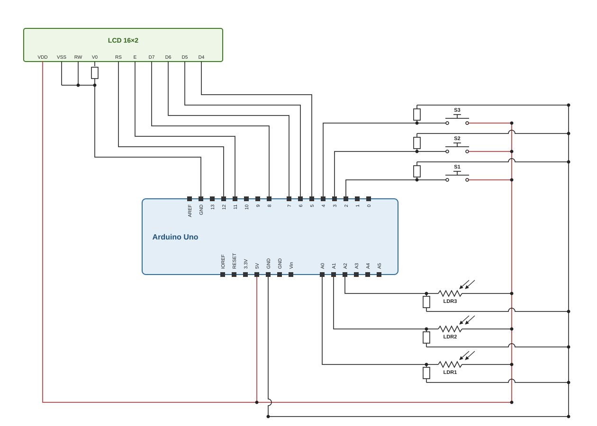

## Kompiliavimas ir paleidimas

Reikia įdiegti [PlatformIO](https://platformio.org/). Tada paleisti programą naudajant.

```bash
pio run -t upload
```

---

## Laikmačio konfigūracija

| Parametras          | Reikšmė                          |
|---------------------|----------------------------------|
| Laikmatis           | Timer1 (biblioteka TimerOne)     |
| Periodas            | 1000 µs (1 kHz)                  |
| Apdorojimo funkcija | `timerTick()`                    |

```cpp
void setupTimer() {
    Timer1.initialize(1000);
    Timer1.attachInterrupt(timerTick);
}
```

| Skaitiklis    | Periodas | Veiksmas                      |
|---------------|----------|-------------------------------|
| `miliseconds` | 1 ms     | Laiko bazė                    |
| `lcdCount`    | 250 ms   | Nustato `updateLCD`           |
| `secCount`    | 1000 ms  | Nustato `CheckCoinsFlag`      |

---

## Pertraukimai (ISR)

| ISR                | Šaltinis                        | Suveikimas        | Veiksmas                             |
|--------------------|---------------------------------|-------------------|--------------------------------------|
| `isrButtonD2()`    | Išorinis pertraukimas INT0 (D2) | `FALLING` frontas | `flagButton[0] = true`               |
| `isrButtonD3()`    | Išorinis pertraukimas INT1 (D3) | `FALLING` frontas | `flagButton[1] = true`               |
| `ISR(PCINT2_vect)` | Būsenos pokytis PCINT20 (D4)    | Bet koks pokytis  | Jei D4 = LOW: `flagButton[2] = true` |
| `timerTick()`      | Timer1                          | Kas 1 ms          | Nustato `updateLCD`, `CheckCoinsFlag` |

```cpp
void isrButtonD2() {
    flagButton[0] = true;
}

void isrButtonD3() {
    flagButton[1] = true;
}

ISR(PCINT2_vect) {
    if (!(PIND & (1 << PD4))) {
        flagButton[2] = true;
    }
}

void timerTick() {
    static uint16_t lcdCount = 0;
    static uint16_t secCount = 0;

    ++miliseconds;

    if (++lcdCount >= LCD_UPDATE_TIME) {
        lcdCount = 0;
        updateLCD = true;
    }

    if (++secCount >= COIN_CHECKING_TIME) {
        secCount = 0;
        CheckCoinsFlag = true;
    }
}
```

---

## EEPROM išdėstymas

| Adresas | Dydis | Laukas        | Tipas      | Aprašymas                |
|---------|-------|---------------|------------|--------------------------|
| 0–1     | 2 B   | `magic`       | `uint16_t` | Tikrinimo žymė `0xABCD`  |
| 2–5     | 4 B   | `totalCents`  | `uint32_t` | Likutis centais          |
| 6–7     | 2 B   | `itemsBought` | `uint16_t` | Nupirktų prekių skaičius |

---

## Schema

